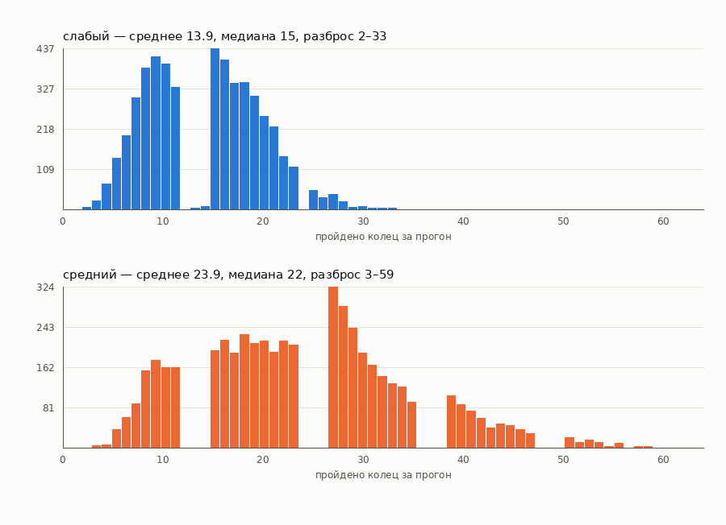
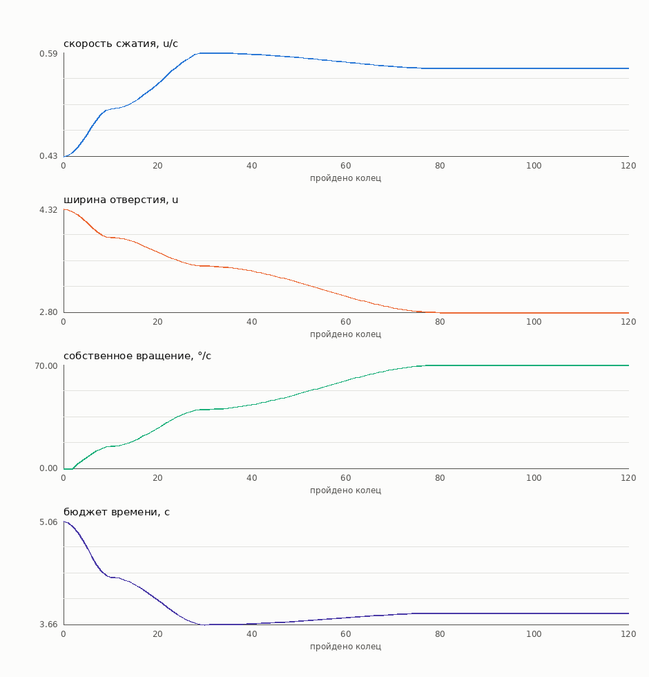

# Отчёт о балансе

Сгенерирован `tools/balance.sh`: симуляция в `HR.Core.BalanceSimulator`, графики — `tools/plot_balance.py`. Исходные числа лежат рядом в `benchmarks/balance-raw.csv` и `benchmarks/balance-curve.csv`.

## Результат

| Уровень | Прогонов | Среднее | Медиана | 10-й проц. | 90-й проц. | Разброс | Что это проверяет | |
|---|---:|---:|---:|---:|---:|---:|---:|---|
| слабый | 5000 | 13.9 | 15 | 7 | 21 | 2–33 | слабее следующего | ✅ |
| средний | 5000 | 23.9 | 22 | 9 | 39 | 3–59 | слабее следующего | ✅ |
| сильный | 5000 | 300.0 | 300 | 300 | 300 | 300–300 | доходит до потолка | ✅ |

Сильный бот упирается в потолок симуляции (300 колец) во всех 5000 прогонах. Это и есть проверка «0 непроходимых колец»: непроходимых ситуаций в кривой нет.

На графике только слабый и средний: у сильного все прогоны заканчиваются на потолке, его гистограмма — один столбик с одним фактом, а общая ось с ним растягивала бы остальных в пять раз и вжимала в левый край. Один факт лучше читается предложением.

## Кривая сложности

Четыре отдельных графика, а не один с четырьмя осями: у величин нет общей единицы, и вторая ось приглашала бы к сравнению, которого нет.

| Кольцо | Сжатие, u/с | Отверстие, u | Вращение, °/с | Бюджет, с | Потолок вращения, °/с |
|---:|---:|---:|---:|---:|---:|
| 0 | 0.427 | 4.32 | 0.0 | 5.06 | 240.7 |
| 10 | 0.502 | 3.90 | 15.0 | 4.30 | 230.3 |
| 20 | 0.541 | 3.69 | 27.5 | 3.99 | 224.8 |
| 30 | 0.591 | 3.48 | 40.0 | 3.66 | 218.0 |
| 40 | 0.589 | 3.41 | 43.1 | 3.67 | 218.3 |
| 50 | 0.583 | 3.24 | 50.6 | 3.70 | 219.0 |
| 60 | 0.576 | 3.04 | 59.4 | 3.75 | 220.0 |
| 70 | 0.569 | 2.87 | 66.9 | 3.80 | 221.0 |
| 80 | 0.566 | 2.80 | 70.0 | 3.82 | 221.4 |
| 90 | 0.566 | 2.80 | 70.0 | 3.82 | 221.4 |
| 100 | 0.566 | 2.80 | 70.0 | 3.82 | 221.4 |

## Что эти числа значат, а что нет

**Значат.** Кривая монотонна и без скачков, непроходимых колец нет, и три уровня мастерства упорядочены так, как должны быть.

**Не значат.** Абсолютные числа здесь не измеряют сложность игры и больше не притворяются, что измеряют. Полосы ожиданий перекалибровывались трижды (D-058, D-059, D-062) и сняты в D-064: симулятор спрашивает то, что игра спрашивать перестала — может ли рука подвести **одно** отверстие к низу и удержать. Летающий шарик выходит в то, до которого долетел, поэтому каждая правка в его пользу двигает модель, не двигая игру. С многоотверстными кольцами расхождение дошло до пятикратного и сменило знак.

**Где измеряется сложность.** В бот-гейте на настоящей физике (`GestureDrivingTests`): средний бот **293–297 из 300**, слабый **98 из 100**. Разброс между прогонами около ±5, поэтому сравнивать слайсы одним прогоном нельзя — только полосой.

**Чего симуляция не моделирует.** Контакт: трение, уводящее шарик с нижней точки, отскок, удары о кромку, и выбор между несколькими отверстиями. Это проверяется отдельно — PlayMode-тестами на настоящей физике.
