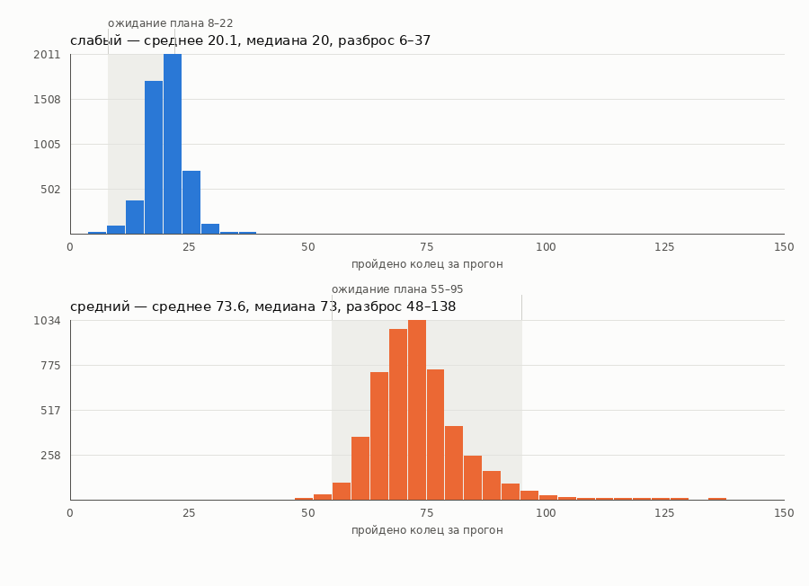
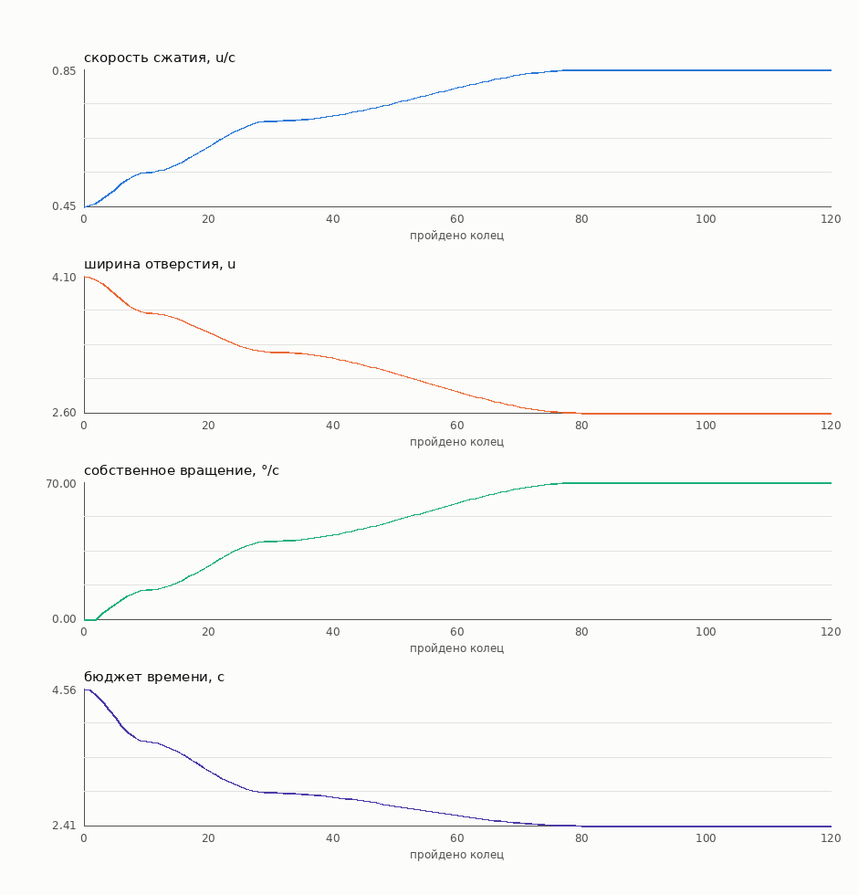

# Отчёт о балансе

Сгенерирован `tools/balance.sh`: симуляция в `HR.Core.BalanceSimulator`, графики — `tools/plot_balance.py`. Исходные числа лежат рядом в `benchmarks/balance-raw.csv` и `benchmarks/balance-curve.csv`.

## Результат

| Уровень | Прогонов | Среднее | Медиана | 10-й проц. | 90-й проц. | Разброс | Ожидание плана | |
|---|---:|---:|---:|---:|---:|---:|---:|---|
| слабый | 5000 | 20.1 | 20 | 16 | 25 | 6–37 | 8–22 | ✅ |
| средний | 5000 | 73.6 | 73 | 64 | 85 | 48–138 | 55–95 | ✅ |
| сильный | 5000 | 300.0 | 300 | 300 | 300 | 300–300 | не падает | ✅ |

Сильный бот упирается в потолок симуляции (300 колец) во всех 5000 прогонах. Это и есть проверка «0 непроходимых колец»: непроходимых ситуаций в кривой нет.

На графике только слабый и средний: у сильного все прогоны заканчиваются на потолке, его гистограмма — один столбик с одним фактом, а общая ось с ним растягивала бы остальных в пять раз и вжимала в левый край. Один факт лучше читается предложением.

## Кривая сложности

Четыре отдельных графика, а не один с четырьмя осями: у величин нет общей единицы, и вторая ось приглашала бы к сравнению, которого нет.

| Кольцо | Сжатие, u/с | Отверстие, u | Вращение, °/с | Бюджет, с | Потолок вращения, °/с |
|---:|---:|---:|---:|---:|---:|
| 0 | 0.450 | 4.10 | 0.0 | 4.56 | 234.1 |
| 10 | 0.550 | 3.70 | 15.0 | 3.73 | 219.5 |
| 20 | 0.625 | 3.48 | 27.5 | 3.28 | 208.5 |
| 30 | 0.700 | 3.27 | 40.0 | 2.93 | 197.6 |
| 40 | 0.716 | 3.20 | 43.1 | 2.86 | 195.3 |
| 50 | 0.753 | 3.03 | 50.6 | 2.72 | 189.8 |
| 60 | 0.797 | 2.84 | 59.4 | 2.57 | 183.3 |
| 70 | 0.834 | 2.67 | 66.9 | 2.46 | 177.9 |
| 80 | 0.850 | 2.60 | 70.0 | 2.41 | 175.6 |
| 90 | 0.850 | 2.60 | 70.0 | 2.41 | 175.6 |
| 100 | 0.850 | 2.60 | 70.0 | 2.41 | 175.6 |

## Что эти числа значат, а что нет

**Значат.** Кривая монотонна и без скачков, непроходимых колец нет, и три уровня мастерства упорядочены так, как должны быть.

**Не значат.** Калибровка «среднего» и «слабого» ботов — это *определение* того, что мы называем средним и слабым игроком, а не независимое подтверждение сложности. Первый замер задал параметры; дальше эти числа работают как страховка от регрессии: если правка кривой сдвинет среднее за пределы диапазона, это будет видно. Независимая проверка здесь ровно одна — сильный бот без шума, который не падает нигде.

**Чего симуляция не моделирует.** Контакт: трение, уводящее шарик с нижней точки, отскок, удары о кромку. Это проверяется отдельно — PlayMode-тестами на настоящей физике.
