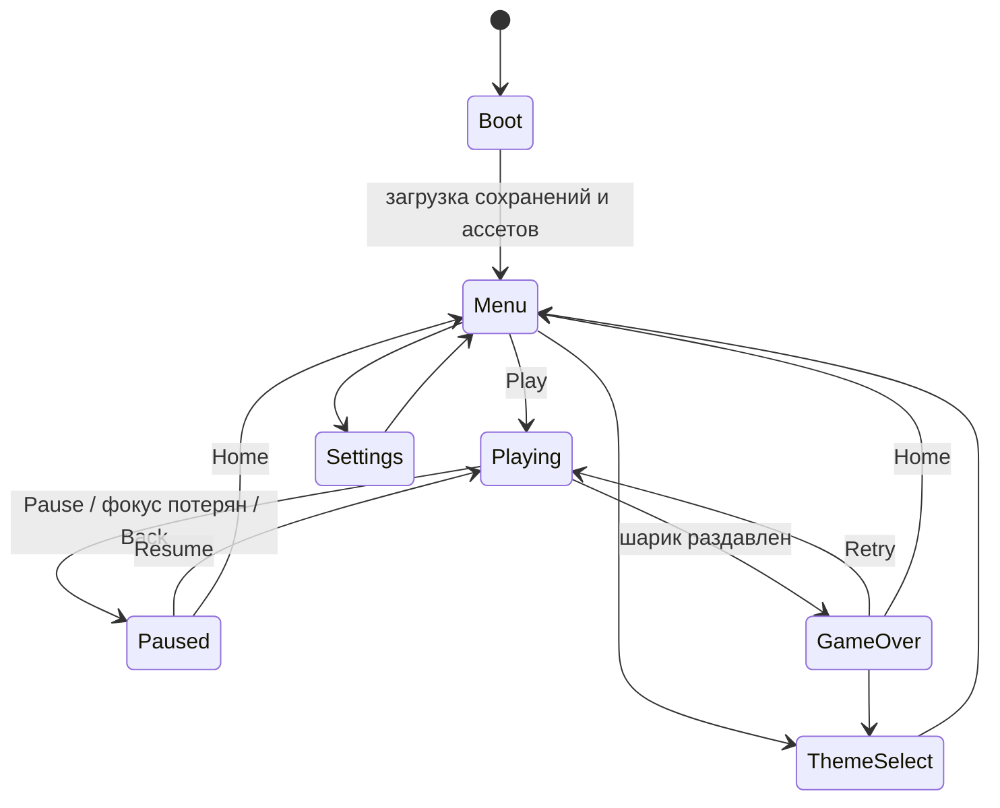

# Hypnotic Rings — спецификация гейм-дизайна, логики и визуала

Назначение: однозначно описать, **как игра выглядит, ощущается и работает**, чтобы Claude Code не додумывал. Дополняет `docs/GDD.md` (общая идея) и `CLAUDE_CODE_PLAN.md` (порядок работ).

**Приоритет документов при конфликте:** `GAME_DESIGN_SPEC.md` (числа, поведение, визуал) → `GDD.md` (идея) → `CLAUDE_CODE_PLAN.md` (процесс). Любое отступление от этого файла — только через запись в `docs/DECISIONS.md` и при прохождении тестов/бот-симуляций.

Все числа ниже — **стартовые значения** для `GameConfig`/`ThemeData` (ScriptableObject). Их можно и нужно подстраивать по результатам бот-симуляций, но структуру и логику менять нельзя без записи в DECISIONS.

---

## 1. Суть игры в одном абзаце

Игрок видит систему концентрических колец. Внутри колец, на нижней дуге одного из них, лежит шарик (гравитация тянет вниз). В каждом кольце есть отверстие. Игрок **водит пальцем по кругу** и этим вращает кольца так, чтобы отверстие оказалось **под шариком** — тогда шарик проваливается в следующий коридор между кольцами (+1 очко). Одновременно весь тоннель **непрерывно сжимается к центру**: если игрок слишком долго не проходит кольцо, шарик будет раздавлен. Сверху появляются новые кольца, и игра бесконечна. Чем дальше, тем быстрее сжатие, быстрее вращение и уже отверстия.

### Что здесь «ядро удовольствия»
1. **Тактильность жеста** — кольца «прилипают» к пальцу, есть лёгкая инерция.
2. **Честная физика** — шарик реально лежит, катится, отскакивает, падает.
3. **Напряжение без паники** — сжатие создаёт давление времени, но игрок всегда видит выход.
4. **Гипноз** — ритмичное вращение, повторяющиеся формы, плавное «втягивание» тоннеля после каждого прохода.

### Ключевое допущение (важно)
Референсы показывают шарик в центре колец. В нашей **2D-физической** версии (требование GDD: `Rigidbody2D`, гравитация) шарик лежит на нижней дуге кольца внутри системы. В момент старта он находится внутри самого малого кольца, ближе к центру, чем в дальнейшей игре. Визуальное «ощущение центра» сохраняется тем, что вся система колец всегда центрирована на экране и стягивается к центру.

---

## 2. Единицы и системы координат

- **Мировая единица `u`** = диаметр шарика. То есть `D = 1u`, радиус шарика `r = 0.5u`.
- Углы: `0°` — вправо, `90°` — вверх, `270°` — вниз (стандарт Unity, против часовой — плюс).
- Центр тоннеля `O = (0, 0)` в мире. Камера ортографическая, смотрит так, что `O` находится на **46% высоты экрана снизу** (чуть выше геометрического центра — оставляет место счёту сверху и ощущение «веса» внизу).
- Гравитация: `(0, -g)`, `g = 14 u/s²` (стартово; подбирается так, чтобы падение сквозь кольцо занимало ≈ 0.35–0.5 с).

---

## 3. Геометрия тоннеля

### 3.1. Параметры колец (стартовые)

| Параметр | Значение | Комментарий |
|---|---|---|
| Толщина кольца `T` | 0.30 u | Физическая = визуальная. Одинакова во всех темах (темы не меняют физику) |
| Просвет коридора `c` | 1.25 u | Между внешней границей внутреннего кольца и внутренней границей внешнего. Шарик 1.0 → запас 0.25 |
| Шаг колец `s = c + T` | 1.55 u | Расстояние между центральными линиями соседних колец |
| Радиус «целевого» кольца `R_target` | 3.0 u | Радиус кольца, на дуге которого лежит шарик, в равновесном состоянии |
| Колец позади шарика | 1–2 | Внутренние, быстро исчезают |
| Колец впереди (снаружи) | 2 видимых + 1 появляется | Поддерживается `K_ahead = 3` существующих |
| Радиус исчезновения `R_vanish` | 0.9 u | Внутренние кольца, не содержащие шарика, исчезают (плавное затухание) |
| Радиус появления | `R_last + s` | Новое кольцо рождается снаружи, ниже уровня видимости по ширине, с нарастанием прозрачности 0 → 1 |

### 3.2. Схема сечения (вид сбоку на нижнюю часть тоннеля)

```
              ... внутренние кольца (позади, исчезают) ...

   ═══════════════  кольцо I (внутреннее, «потолок» коридора)
        ▲
        │  c = 1.25u  (просвет коридора)
        ▼
         ●           шарик D = 1.0u, лежит на «полу»
   ═══════════════  кольцо E (внешнее, «пол», на нём лежит шарик)
                     ↑ T = 0.30u
        ▲
        │  c
        ▼
   ═══════════════  кольцо E+1 (следующий пол, в нём отверстие — цель)
```

Шарик лежит в **коридоре** между кольцом I (над ним) и кольцом E (под ним). «Пол» — внутренняя поверхность нижней дуги кольца E.

### 3.3. Схема в плане (весь экран)

```
                 · · · · · ·            ← кольцо появляется (alpha 0→1)
            ╭─────────────────╮
         ╭──╯   ╭─────────╮    ╰──╮     ← кольцо E+2 (отверстие сверху)
        │      ╭╯  ╭───╮   ╰╮      │
        │     │   │  ·  │   │     │     ← центр O; внутренние кольца «втянулись»
        │      ╰╮  ╰───╯   ╭╯      │
         ╰─╮    ╰──● ──────╯     ╭─╯    ← шарик на нижней дуге кольца E
            ╰───── ○ ○ ○ ──────╯         ← отверстие в кольце E+1 под шариком
```

(схема условная; точная картинка — референсы `ref_minimal.png` и `ref_neon.png`)

### 3.4. Устройство одного кольца

- Кольцо = **дуга 360° минус отверстие**. Центральная линия на радиусе `R`, толщина `T`.
- **Физика**: тело кольца разбито на 3–4 дуговых сегмента (каждый ≤ 120°) для коллайдеров. Допустимо `PolygonCollider2D` с точками дуги, шаг дуги ≤ 7.5°, либо цепочка `CapsuleCollider2D`. Отверстие — **пустое пространство без коллайдеров**.
- **Отверстие** задаётся **длиной дуги** `w` (в `u`), а угловая ширина `θ = w / R` пересчитывается при сжатии, так что реальная проходимость отверстия не уменьшается из-за уменьшения радиуса. Минимум `w_min = 1.5 u` (шарик 1.0 + запас 0.5) — ни при каких условиях меньше.
- **Концы отверстия**: в теме Monochrome скруглённые (как `ref_minimal`), в Neon прямые срезы (как `ref_neon`). Физически концы всегда имеют закругление радиусом `T/2` (капсульная кромка — шарик не застревает на острых углах).
- **Отдельный сегмент-«шов»** (тонкая линия между цветными сегментами, как на `ref_neon`) — чисто косметика, физику не меняет.
- У кольца есть: `id`, радиус `R`, угол центра отверстия `gapAngle`, ширина `w`, автономная угловая скорость `ω_auto` (°/с), число отверстий (1 в начале), `colorIndex`.

### 3.5. Кто за что отвечает (обязательные границы ответственности)

| Модуль | Отвечает | Не отвечает |
|---|---|---|
| `RingController` | геометрия, вращение, радиус, коллайдеры | цвет, звук |
| `RingMeshBuilder` | процедурная сетка дуги | физика |
| `TunnelController` | контроль сжатия (раздел 5), удаление/спавн колец | вращение пальцем |
| `RingGenerator` | параметры следующего кольца (с проверкой проходимости) | отрисовка |
| `ThemeApplier` | цвета/толщина визуала/формы концов в пределах разрешённого | любая физика |

---

## 4. Шарик и физика

| Параметр | Значение |
|---|---|
| Диаметр | 1.0 u |
| Масса | 1 |
| `gravityScale` | 1 (g = 14 u/s² в настройках проекта) |
| Физ. материал шарика | трение 0.25, упругость (restitution) 0.2 |
| Физ. материал колец | трение 0.25, упругость 0.0 |
| Collision detection | Continuous, Interpolate |
| Макс. скорость шарика | 12 u/s (ограничение в `FixedUpdate`) |
| Фиксированный шаг | 1/90 с (проверить 1/60 и 1/120 в фазе 1, выбрать лучший) |

### Поведение
- **Лежит**: шарик стоит на нижней дуге; при вращении кольца **трение слегка увлекает его в сторону** (шарик может немного закатываться вверх по стенке, но гравитация возвращает вниз). Это нужно: игрок чувствует физику, а шарик не «приклеен» к 270°.
- **Падает**: когда отверстие оказывается под шариком достаточно широко (`w ≥ 1.5u`), шарик проваливается в следующий коридор и приземляется на следующее кольцо (небольшой отскок и затухание).
- **Не телепортируется** и не двигается заранее заданной анимацией.
- **Защита от туннелирования**: толщина коллайдера не меньше визуальной, макс. скорость ограничена, кинематическое движение колец через `MovePosition/MoveRotation`.

### Условие «шарик прошёл кольцо»
Шарик считается прошедшим кольцо E, когда **центр шарика оказался за внешней границей кольца E** (расстояние центра шарика до `O` больше `R_E + T/2 + 0.3`), и шарик **находится в коридоре кольца E+1** (последующий пол). Событие `OnRingPassed(ringId)` вызывается **ровно один раз**.

---

## 5. Сжатие тоннеля (главная механика давления)

### 5.1. Идея
Все кольца движутся к центру. Это даёт две вещи: (1) **давление времени** (медленное постоянное сжатие), (2) **ощущение бесконечного тоннеля** (после каждого прохода тоннель плавно «втягивается», возвращая систему в центр экрана).

### 5.2. Формула
Радиус каждого кольца уменьшается со скоростью `v_eff`:

```
v_eff = clamp( v_base + k_pull * (R_E - R_target),  v_base,  v_max )
R_i(t+dt) = R_i(t) - v_eff * dt
```

где `R_E` — радиус кольца, на котором сейчас лежит шарик.

- `v_base` — базовая скорость сжатия (растёт со сложностью): **0.15 → 0.60 u/s**.
- `k_pull = 3.0 1/s` — «возврат к центру»: сразу после прохода кольца `R_E` вырастает на `s ≈ 1.55`, поэтому `v_eff` на полсекунды-секунду возрастает до ~4 u/s и тоннель плавно втягивается обратно.
- `v_max = 4.0 u/s`.
- Все кольца сжимаются **с одной и той же скоростью**, поэтому просвет `c` и шаг `s` остаются постоянными (физика коридоров стабильна).

### 5.3. Что происходит с кольцами
- Кольцо без шарика внутри при `R < R_vanish` (0.9 u) **плавно гаснет и возвращается в пул**.
- Кольцо, **внутри которого находится шарик, не удаляется** — оно может сжиматься вплоть до раздавливания.
- Новое кольцо снаружи создаётся из пула, когда число существующих колец **снаружи** от кольца шарика становится меньше `K_ahead = 3`.

### 5.4. Условие проигрыша — «раздавлен»
Если у кольца E, в котором лежит шарик, **нет внутреннего кольца** (все внутренние исчезли), то свободный радиус диска внутри него `ρ_E = R_E - T/2`. 

```
Проигрыш, если  ρ_E ≤ r + crushMargin     (r = 0.5, crushMargin = 0.05)
```

То есть шарик раздавлен, когда внутренняя пустота сократилась до размера шарика. Проверка геометрическая, не через коллизии. Дополнительно: проигрыш при выходе шарика за допустимую зону (расстояние до `O` > `R_E + 2s`) — защита от багов.

### 5.5. «Бюджет времени» на кольцо
Для равновесного состояния время от прохода до раздавливания ≈ `(R_target - T/2 - r - crushMargin) / v_base = (3.0 - 0.15 - 0.55) / v_base ≈ 2.3 / v_base`:

| `v_base` | Время на кольцо до раздавливания |
|---|---|
| 0.15 (старт) | ≈ 15 с |
| 0.30 | ≈ 7.7 с |
| 0.60 (поздняя игра) | ≈ 3.8 с |

Это **время на выравнивание отверстия под шариком** — оно и есть главный регулятор сложности наряду с ширинами отверстий и вращением.

---

## 6. Управление

### 6.1. Схема
- Игрок касается **в любом месте экрана** (не только на кольцах) и ведёт палец. Центр жеста — экранная проекция `O`.
- Угол касания `φ = atan2(touch - O_screen)`. Дельта угла за кадр `Δφ` (с нормализацией через ±180°) умножается на `sensitivity` и **добавляется ко всем кольцам** (`userAngle += Δφ * sensitivity`).
- Все кольца вращаются на один и тот же пользовательский угол — одним жестом (требование GDD для MVP).
- Дополнительно каждое кольцо имеет **автономное вращение** `ω_auto` (раздел 7) — оно складывается с пользовательским.

### 6.2. Параметры (`GameConfig`)
| Параметр | Значение |
|---|---|
| `sensitivity` | 1.0 (палец на 90° → кольца на 90°) |
| `maxUserAngularSpeed` | 540°/с |
| `inertiaDecay` | 5.0 1/с (после отпускания скорость падает экспоненциально) |
| `deadZoneRadius` | 0.6 u в экранной проекции (внутри радиуса касание игнорируется, чтобы не было скачков у центра) |
| Инверсия | опция в настройках |
| Мультитач | учитывается только первый палец |

### 6.3. Граничные случаи (обязательны к тестам)
- Касание в самом центре — нет деления на ноль и скачков.
- Резкий рывок через угол ±180° — нет разворота в обратную сторону.
- Палец ушёл за экран — вращение плавно затухает по инерции.
- Пауза/сворачивание во время жеста — жест сбрасывается, инерция обнуляется.

---

## 7. Сложность и генерация

Сложность — функция **числа пройденных колец `n`** (счёта). Значения интерполируются **плавно** (кривые `AnimationCurve`/ease-out), без скачков более 15% между соседними кольцами.

| Параметр | n = 0–2 (обучение) | n = 10 | n = 30 | n = 80+ |
|---|---|---|---|---|
| `v_base` (u/s) | 0.15 | 0.22 | 0.38 | 0.60 |
| Ширина отверстия `w` (u) | 3.2 | 2.8 | 2.2 | 1.6 |
| `ω_auto` кольца (°/с), по модулю | 0 | 12 | 35 | 70 |
| Направления соседних колец | все одинаково | чередуются | случайные, разные скорости | случайные, разные скорости |
| Число отверстий | 1 | 1 | 1 (иногда 2 по 0.6w каждое) | 1–2 |
| Время на кольцо до раздавливания (оценка) | ≈15 с | ≈10 с | ≈6 с | ≈3.8 с |

Правила:
- **Первые 3 кольца** — обучение: кольца не вращаются сами, отверстия широкие, сжатие медленное.
- Каждое новое кольцо получает случайное положение отверстия, **но**:
- **Проходимость гарантируется генератором** (обязательное правило): угловое расстояние от предполагаемой позиции шарика до отверстия `Δ` (в градусах, минимальное по модулю) с учётом `ω_auto` должно удовлетворять

```
|Δ| / (ω_comfort - |ω_auto|)  ≤  0.6 * T_budget
```

где `ω_comfort = 200°/с` (комфортная скорость пальца), `T_budget` — бюджет времени из таблицы 5.5 для текущего `v_base`. При `|ω_auto| ≥ ω_comfort` значение `ω_auto` обрезается до `0.5*ω_comfort`. Если условие не выполняется — генератор сдвигает отверстие, пока не выполнится.
- Скорость автономного вращения соседних колец **различается** не менее чем на 20% (кроме обучающих).
- Сид генерации сохраняется (для воспроизводимых баг-репортов и тестов).

**Результат баланса определяется ботом-игроком**, а не интуицией: средний бот в среднем проходит 25–60 колец, слабый — 8–20, кривая сложности монотонна (см. план, фаза 4).

---

## 8. Счёт и прогресс

- +1 очко за каждое пройденное кольцо. Больше ничего в MVP (никаких комбо и множителей).
- Рекорд — лучший счёт. Сохраняется. Если счёт превысил рекорд в этой попытке — на экране проигрыша показывается «Новый рекорд».
- **Открытие тем по рекорду** (честно и без покупок):

| Тема | Условие |
|---|---|
| Monochrome | сразу |
| Midnight | сразу |
| Neon | сразу |
| Pastel | рекорд ≥ 25 |
| Earth | рекорд ≥ 50 |

(Три основные темы MVP доступны сразу, чтобы выполнялся критерий «три темы можно переключать».)

---

## 9. Состояния игры и поток экранов



### Первые 60 секунд (опыт новичка)
1. Меню. Нажал Play → плавное появление тоннеля (0.4 с).
2. Шарик лежит в малом кольце. Подсказка (только в первый запуск): надпись «Проведи пальцем по кругу» и анимированный жест; исчезает после первого поворота колец.
3. Кольца 1–3 неподвижны, отверстия широкие, сжатие медленное — игрок понимает связь «жест → вращение → шарик падает».
4. После 3-го кольца начинается автономное вращение; чувство «тоннель втягивается» после каждого прохода.
5. К 10–15 кольцу игрок начинает чувствовать давление сжатия.
6. Раздавлен → анимация «кольца смыкаются», 0.8 с, экран проигрыша без задержки на Retry.

---

## 10. Интерфейс (портретный экран)

### 10.1. Игровой экран
```
┌────────────────────────────┐
│ [II]                        │   ← пауза: правый верх, 48dp, в safe area
│            12              │   ← счёт: крупно, по центру сверху (как на ref_neon)
│          Best 47           │   ← рекорд: мелко под счётом, 60% прозрачности
│                            │
│       ╭───────────╮        │
│     ╭─╯  ╭─────╮   ╰─╮     │
│    │    ╭╯ ╭─╮ ╰╮     │    │   ← тоннель, центр O на 46% высоты снизу
│    │   │   │·│   │    │    │
│     ╰─╮ ╰╮  ╰●╯  ╭╯ ╭─╯     │
│       ╰──╰─────╯──╯        │
│                            │
│                            │   ← нижняя зона свободна для пальца
└────────────────────────────┘
```
Правила: счёт анимируется при +1 (лёгкий «пульс» масштаба 1.0 → 1.15 → 1.0 за 150 мс). Интерфейс не перекрывает игровое поле.

### 10.2. Главное меню
```
┌────────────────────────────┐
│                            │
│       HYPNOTIC RINGS       │   ← название, тонкий шрифт
│         ◎ (анимация)       │   ← медленно вращающиеся кольца в текущей теме
│                            │
│          [  PLAY  ]        │   ← большая кнопка
│                            │
│         Best: 47           │
│     [ Темы ]  [ ⚙ ]       │
└────────────────────────────┘
```

### 10.3. Экран проигрыша
```
┌────────────────────────────┐
│                            │
│           23               │   ← итоговый счёт, крупно
│     NEW BEST! / Best 47    │
│                            │
│       [  RETRY  ]          │
│     [ Home ]  [ Темы ]     │
└────────────────────────────┘
```
Фон — замершая сцена, затемнённая на 40%; Retry занимает нижнюю треть для быстрого перезапуска.

### 10.4. Выбор темы
Горизонтальная карусель из карточек: превью (живой мини-тоннель в цветах темы), название, замок и условие открытия для закрытых. Выбор применяется сразу и сохраняется.

### 10.5. Настройки
Звук (вкл/выкл + громкость), Музыка (вкл/выкл + громкость) — **независимо**; Чувствительность (слайдер 0.6–1.6); Инверсия вращения; Вибрация; Снизить эффекты; Язык (Авто/RU/EN); Сброс прогресса (с подтверждением); «О игре/Политика конфиденциальности».

### 10.6. Общие требования к UI
- `CanvasScaler`: Scale With Screen Size, опорное 1080×1920, match 0.5.
- Safe Area учитывается (вырезы, жестовая панель).
- Шрифт: тонкий геометрический без засечек (в проекте — TextMeshPro, набор Latin + Cyrillic). Цифры счёта — тот же шрифт, начертание Light/Regular.
- Минимальная цель касания 48dp.
- Кнопка «Назад» Android: игра → пауза; пауза → продолжить; меню → выход.

---

## 11. Визуальный стиль

### 11.1. Общие принципы
- Минимализм: только кольца, шарик, фон, счёт. Никаких декоративных деталей.
- **Активное кольцо** (то, на котором лежит шарик) и следующее — на 100% непрозрачности; внутренние (позади) уменьшаются по прозрачности; новые (появляются) растут от 0. Это направляет взгляд и создаёт глубину.
- **Эффект глубины** — только цвет/прозрачность, физическая толщина не меняется.
- Плавность: всё движение интерполируется, никаких резких скачков UI.
- Камера: орто, статична, без дрожания (кроме короткого шейка при раздавливании).

### 11.2. Что брать с референсов
| Референс | Берём | Не берём |
|---|---|---|
| `ref_minimal.png` | Чёрные кольца со скруглёнными концами, ровная толщина, пустой белый фон, шарик в центре, много воздуха | Шарик у кольца в центре — физика кладёт его на дугу |
| `ref_neon.png` | Тёмно-синий фон, кольца разных цветов (синий/жёлтый/фиолетовый), толстые плоские сегменты со швами, счёт белым тонким шрифтом сверху по центру, лёгкое ослабление цвета у внутренних колец | Разная толщина колец по радиусу (мы держим толщину постоянной ради физики) |

### 11.3. Темы

Цвета — стартовые, после реализации **обязательна автопроверка контраста** (отношение яркости ≥ 3:1 для пар шарик/фон, шарик/кольцо, кольцо/фон; при провале подправить оттенок и записать в DECISIONS).

| Тема | Фон | Кольца (цикл по индексу) | Шарик | UI/счёт | Концы |
|---|---|---|---|---|---|
| **Monochrome** | `#FAFAFA` | `#111111` | `#111111` + обводка цветом фона 0.06u | `#111111` | скруглённые, одно сплошное кольцо без швов |
| **Midnight** | `#0B1020` | `#E8ECF4` (внутренние тусклее) | `#FFB703` | `#E8ECF4` | скруглённые |
| **Neon** | `#121A33` | `#2D7FF0`, `#FFEC6B`, `#2D7FF0`, `#8B3FF0` | `#C77DF2` с лёгким свечением | `#FFFFFF` | прямые, швы между сегментами на 6 сегментов |
| **Pastel** | `#FDF6F0` | `#F4A6A6`, `#A6D8F4`, `#B8E6C1`, `#FFE0A3` | `#5C5470` | `#5C5470` | скруглённые |
| **Earth** | `#EADDC8` | `#3F5E3A`, `#6B4F3A`, `#8A7A52` | `#C2562B` | `#3B2F26` | скруглённые |
| **Custom** | — | через `ThemeData` | — | — | — |

Параметры `ThemeData`: `background`, `ringColors[]`, `ballColor`, `ballOutline`, `uiColor`, `endCapStyle` (Round/Flat), `segmentSeams` (bool), `depthFade` (0..1), `glow` (0..1), `visualThicknessScale` — **только 1.0** (запрещено менять визуальную толщину отдельно от физической). Тест: смена темы не меняет ни одного физического параметра.

### 11.4. Эффекты (минимальный набор, отключаются «Снизить эффекты»)
- След шарика: короткий, 6–8 точек, затухающий.
- При проходе кольца: мягкая вспышка цвета кольца 120 мс на месте отверстия + пульс счёта.
- Втягивание тоннеля: само по себе визуальное событие (раздел 5.2) — ничего добавлять не нужно.
- При раздавливании: кольца на 0.4 с стягиваются вокруг шарика, затухание, лёгкий шейк камеры (амплитуда 0.08u).
- Переходы меню↔игра: плавное появление/затухание за 0.3–0.4 с.
- Вибрация: короткий импульс (20 мс) на проход, средний (60 мс) на проигрыш.

---

## 12. Звук

| Событие | Звук | Характер |
|---|---|---|
| Фон | Ambient pad, бесшовный луп 60–90 с | тихий, низкие и средние частоты, без мелодии |
| Проход кольца | Короткий мягкий тон 150–250 мс | высота по пентатонике, шаг вверх при серии проходов подряд (за 3 сек), сброс при паузе |
| Касание шарика о кольцо | Тихий «тик/стук» | громкость зависит от скорости удара |
| Проигрыш | Низкий мягкий затухающий звук 0.6–0.8 с | без резкости |
| UI | Короткий клик | негромкий |

Требования: пик ≤ −1 dBFS, суммарно < 5 МБ, лупы без щелчков, музыка и эффекты включаются/выключаются независимо. Звук синтезируется скриптом `tools/gen_audio.py` (ассеты не скачиваются).

---

## 13. Критерии приёмки механики (Given / When / Then — в виде тестов)

1. **Лежит на дуге**: Given шарик на нижней дуге, When кольцо вращается, Then шарик остаётся внутри коридора и не проваливается сквозь сплошной сегмент.
2. **Проход**: Given отверстие шириной `w ≥ 1.5u` под шариком, When проходит ≥ 0.3 с, Then шарик падает в следующий коридор, `OnRingPassed` вызван один раз, счёт +1.
3. **Узкое отверстие**: Given `w < 1.2u`, Then шарик не проходит (проверка, что физика не «натягивает» проход).
4. **Сжатие**: Given `v_base = 0.3`, When 10 с без прохода, Then радиус каждого кольца уменьшился ≈ на 3.0 u (±5%), просвет `c` не изменился.
5. **Втягивание**: Given шарик прошёл кольцо, When прошло 1.2 с, Then `|R_E - R_target| < 0.15`.
6. **Раздавливание**: Given шарик не проходит дольше `T_budget`, Then срабатывает проигрыш ровно при `ρ_E ≤ r + crushMargin`.
7. **Проходимость**: Given 5 000 сгенерированных колец, Then для «сильного» бота (без шума) 100% проходимы.
8. **Темы**: Given любая смена темы, Then хэш физических параметров не изменился.
9. **Рестарт**: Given 50 рестартов, Then число активных объектов и память стабильны.
10. **Жест**: Given касание у центра/через ±180°/за границей экрана, Then нет скачков угла и исключений.

---

## 14. Что запрещено в MVP

Реклама, внутриигровые покупки, онлайн-сервисы, аналитика, таблицы лидеров, достижения, ежедневные задания, мультиплеер, облачные сохранения, управление отдельными кольцами, 3D-графика. Всё это — в `docs/BACKLOG.md`.

---

## 15. Что Claude Code должен сделать с этим файлом в первую очередь

1. Скопировать его в `docs/GAME_DESIGN_SPEC.md`.
2. Добавить в `CLAUDE.md` строку: «Поведение и числа — в `docs/GAME_DESIGN_SPEC.md`; при конфликте он главнее GDD».
3. Перенести числовые параметры в `GameConfig`, `DifficultyCurve`, `ThemeData` (ничего не хардкодить).
4. Реализовать тесты раздела 13 как автоматические (PlayMode/EditMode) на фазах, к которым они относятся.
5. Любое отклонение от формул/чисел — через `docs/DECISIONS.md` с доказательством (результат бот-симуляции).
